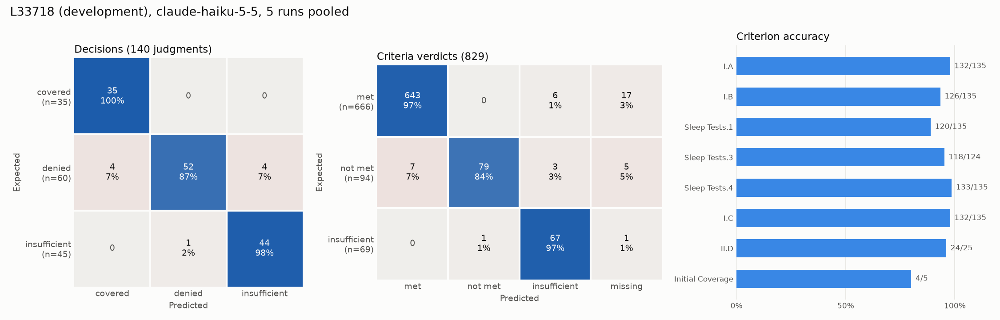
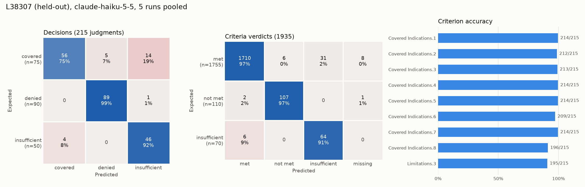

# Project Overview

I created a webapp that hosts a suite of healthcare tools focused on 835 remittances, like checking the structure and balance of 835s, and predicting if an order is covered under Medicare. The entirety of this file is focused on this second tool; other tools are detailed in the appendix.

# Prior Authorization Checker Tool

Given a patient FHIR file and an order, the tool predicts if the order is covered under Medicare. The result can be one of three values: "covered", "denied," or "insufficient information," if there isn't enough information in the patient file to make a clear determination.

# Background

### Medicare

Medicare is a federal health insurance program for people at least 65 years old, and for younger people with certain disabilities.

### FHIR files

Fast Healthcare Interoperability Resources (FHIR) is a standard applied to files; each patient file is an FHIR bundle of resources and includes data like Patient (personal information), Observation (lab results), and Encounters (doctor visits). The files use json format, which makes them computationally easy to parse.

### LCD files

An order is only covered under Medicare if certain criteria are met. For example, a CPAP device is covered only if a sleep test shows an AHI of at least 15, or 5–14 with symptoms such as daytime sleepiness or hypertension. Coverage criteria come from national coverage determinations (NCDs) or, more often, from local coverage determinations (LCDs). Typically, items do not have any NCDs and only have local coverage determinations (LCDs), created by local contractors, Medicare Administrative Contractors (MACs), who specify requirements in their own local jurisdiction. LCDs must yield to NCDs and cannot override them.

### 835 remittance files

An 835 is the X12 electronic remittance advice. It explains a payment (but it itself is not a payment), including paid amounts, adjustments, and denials, and contains payer, patient, and payment information. It may include partial or full denials as well.

# Scope

The tool checks one thing: whether a patient's record supports the clinical criteria in the Medicare policy that governs an order. It is decision support for whoever prepares a coverage request, not a coverage determination.

It does not check administrative requirements (see Design for why):
- whether the provider or supplier is enrolled in Medicare, credentialed or accredited
- whether the device is FDA-approved
- the place of service, billing codes and modifiers
- whether the claim and its documentation meet Medicare's billing rules

These aren't in a patient's chart; they live in other systems. Provider enrollment and accreditation are in Medicare's enrollment and credentialing databases, device approval is in FDA records, and the place of service, codes and modifiers are on the claim, which billing staff fill in. Payers check them mostly with automated lookups and claim edits, while nurse reviewers or medical directors read the clinical documentation against the policy's criteria. That clinical review is the judgment-heavy part, and it's the part this tool does.

Other limits on scope:
- **Medicare only.** The tool uses Medicare LCDs, not the policies of Medicare Advantage or commercial plans, and only those in a fixed corpus of about 25 sleep-related LCDs.
- **Synthetic data only.** It was built and tested on Synthea patients, and the web app is not set up to handle real patient records (PHI).
- **Not reviewed by a clinician.** Neither the tool's outputs nor the answer keys used to evaluate it were checked by a clinician or coding professional (see Limitations).
- **Restricted uploads.** The deployed site only runs on five synthetic demo patients, with results computed ahead of time. Additionally, uploads are turned off completely, to prevent PII from accidentally being uploaded.

# Architecture

There are several different levels of architecture:
1. Offline: `cms_data_retrieval.py` -> provides data and lcd info -> `policy_store.py` -> stored in Chromadb
2. Per request: FastAPI form (main.py) with FHIR file + order code inputs. Then:
    - summarize_fhir_record: compact, tagged patient summary (last 2 years)
    - order code + description → Chroma: top 3 distinct policies, with their matching passages
    - Haiku call 1 (low effort): pick the governing LCD, or "none"
    - Haiku call 2 (high effort): full LCD text + summary -> criteria, verdicts, evidence, decision
    - results page: each verdict with its evidence
3. Evaluation: `build_cases.py` -> builds patient files + answer keys -> `evaluate.py` -> produces raw json results ->  `analyze_results.py`

A few notes on these:
- Policy selection only sees retrieved Chroma DB chunks, whereas judging sees the full LCD. Passages are enough to tell policies apart, but judging requires the full context.
- Evaluation results are reused while the model, prompts, and schema are unchanged.
- We don't use a fallback model. If a different model answered some cases, it would confound the evaluation.

# Design

The prior auth tool predicts coverage through a four-step process:
1. **Select a patient FHIR file and order for coverage prediction.** A user uploads an FHIR file and inputs an order on the web app.
2. **Select the right policy (LCD).** The code's official description is looked up in the LCDs' code lists (`order_codes.json`), and the search query is the code plus that description. The Chroma vector store is searched with this query and we return the top 3 best-matching distinct policies. Haiku can also answer "none" in case we don't find a match. The LCD corpus holds about 25 sleep-related LCDs that share vocabulary (PAP, sleep studies, HGNS, etc.) that make this a meaningful test of policy selection.
3. **Predict order coverage.** The LCD and a summary of the FHIR record are sent to Haiku, and I ask Haiku to determine if each criterion listed in the LCD file is met, not met, insufficient information, or not applicable, based on provided patient data. If all criteria are met, the order is covered; if any criteria are not met, the order is denied; otherwise (nothing not met, but at least one criterion lacks evidence), insufficient information.
4. **Display the information.** Last, I display each criterion to the user and its individual decision, along with evidence for each decision from the patient file.

LCDs mix two kinds of requirements. Clinical requirements are about the patient and their care, things a medical record documents: the AHI on a sleep study, BMI, whether CPAP was tried. Administrative requirements are about the providers, facilities, devices and paperwork: whether the surgeon who performs the DISE is certified, whether the device is FDA-approved, which place of service it's furnished in, how the claim is billed. A patient's chart doesn't record these, so a tool reading only the chart could never judge them; it would answer "insufficient information" for every patient.

The judging prompt therefore tells the model to leave out administrative requirements (provider and facility credentials, accreditation or enrollment; regulatory status of devices or tests; billing, ordering and claim documentation rules) while keeping requirements about what the patient received, such as what kind of test was done and who ordered it, which are clinical. The answer keys leave out the same requirements.

# Evaluation

The goal of the evaluation step is to determine prediction accuracy. I discuss both the evaluation method, and the process of selecting which LCDs to test.

### Method
Our evaluation method consists of several steps:
1. **Obtaining test patient data.** I use Synthea (https://synthea.mitre.org/) to generate fake patient data for testing.
2. **Modify patient files so criteria are explicitly met or unmet.** I add encounters, labs, and other resources to Synthea patient files to test the prior auth prediction pipeline. At the same time, I record each modification in "answer key" files, which are later compared against model prediction to calculate accuracy. This way, I know exactly which modifications have been made and what the ground truth is for each patient.
3. **Run the tool and compare its output with the answer key.** At the same time, I keep track of several variables, including how often we select the right policy, how often the model predicts the correct decision, and how often the model cites sufficient evidence for its determination. Note that for decision accuracy, I split each accuracy metric into its own permutation of expectation/prediction. For example, how often the model selected "covered" when the answer was "denied" is a separate metric from how often the model selected "insufficient" when the answer was "covered", and so on.

Each test case starts from a fully qualifying patient and changes one thing. In cases.py, a case is a base Synthea patient plus the settings ("levers") that differ from the defaults, and the defaults describe a patient who meets every criterion. For example, case_044 is a qualifying HGNS patient except that no shared decision making is documented (one criterion lacks evidence, so the expected decision is insufficient information). Because most cases change a single lever, a wrong answer points to one criterion. A few cases change two levers on purpose, to check that verdicts combine correctly: one "not met" plus one "insufficient" should still be "denied".

Most levers have three kinds of setting: one that meets the criterion, one that fails it (the record shows something that breaks the rule), and one that leaves it out (the record says nothing, so the correct verdict is "insufficient information"). Boundary values are tested too, such as AHI exactly 15 or 65 and BMI 34.9.

The answer key is computed from the same lever settings rather than read off the finished record, so the ground truth is known by construction. Before any model sees a case, a validation step checks that the record is consistent and that every piece of evidence the key requires appears in the patient summary the model receives. Base patients that already have a condition affecting a criterion (heart failure for HGNS, for example) are rejected.

### LCD Selection

I use order E0601 (continuous positive airway pressure device coverage for obstructive sleep apnea) for the development set, and 64582 (implantation of hypoglossal nerve neurostimulator system) for the held-out set. I create a couple dozen patient examples with varying qualifications for both orders. Then, I tune the prompt to increase its accuracy across the development set, then run the evaluation on the held-out set with minimal changes to determine generalizable accuracy.

After the first-run on the held-out set, we made a few of changes, as policy selection failed on 15 of the 17 cases. None of the modifications affect criterion judging. Modifications: Changes on the held-out set included:
1. Changing test cases to only include patients with Medicare
2. Allowing regional versions of the same policy to be interchangeable
3. Fixing the scores label matching after seeing held-out results, so the results were more accurate (only affects scoring)

In addition to the above changes, I created 26 additional test cases for better converage.

### Results

#### Headline numbers

Every test case was run 5 times, and each run of a case counts as one judgment. L33718's 28 scored cases give 140 judged decisions, and L38307's 43 cases give 215. L33718's 29th case is scored on policy selection only. Table 1 pools all runs, and its rows mean:

- **Policy selection:** how often the model picked the right LCD. Any contractor's version of the policy counts.
- **Decision accuracy:** how often the final decision (covered, denied or insufficient information) matched the answer key. The range is the worst and best of the 5 runs.
- **Criterion accuracy:** how often a single criterion's verdict matched the answer key.
- **False covers:** judgments where the model said "covered" but the answer key said "denied" or "insufficient information". This is the costliest error.
- **Unstable cases:** cases whose decision was not the same in all 5 runs.

**Table 1: headline results, 5 runs pooled**

| | L33718 (development: PAP) | L38307 (held-out: HGNS) |
|---|---|---|
| Policy selection | 142/145 (98%) | 214/215 (99.5%) |
| Decision accuracy | 94% (89–100% by run) | 89% (86–91% by run) |
| Criterion accuracy | 95% | 97% |
| False covers | 4/140, all from one case (case_008) | 4/215, from two cases (case_044, case_068) |
| Unstable cases | 5 of 28 | 12 of 43 |

Table 2 breaks the pooled numbers out by run, to show how consistent the model is from one run to the next. Each run judges every case once. Decision accuracy on L33718 swings more (89–100%) than on L38307 (86–91%), partly because each L33718 case is a larger share of its smaller set: one case changing its answer moves L33718's accuracy by about 4 points, and L38307's by about 2.

**Table 2: results by run** (from `python analyze_results.py`)

| Run | L33718 decisions | L33718 criteria | L33718 false covers | L38307 decisions | L38307 criteria | L38307 false covers |
|---|---|---|---|---|---|---|
| 1 | 89% | 96% | 1 | 88% | 97% | 0 |
| 2 | 93% | 94% | 1 | 86% | 98% | 1 |
| 3 | 100% | 99% | 0 | 91% | 96% | 0 |
| 4 | 96% | 97% | 1 | 88% | 98% | 2 |
| 5 | 89% | 90% | 1 | 91% | 96% | 1 |
| **Mean** | **94%** | **95%** | **0.8** | **89%** | **97%** | **0.8** |

Figure 1 displays two confusion matrices for the development set data (PAP devices for sleep apnea, LCD L33718). The expected decision is on the rows, and the model's prediction is on the columns. The left-most confusion matrix represents decisions (covered/denied/insufficient for an *order*), and the right-most matrix represents criterion verdicts (met/not met/insufficient for a *criterion*). LCDs contain several criteria that make up a decision for an order, and we display decision selection separately for orders and criteria.

The diagonals display correctly-predicted selection. Covered accuracy was 100% (when covered was expected, the model predicted covered in 100% of cases), denied accuracy was 87%, and insufficient accuracy was 98%. The model struggles the most with predicting expected denials. Predicting covered when the expected is denied is the most costly mistake, as telling a patient their order is covered when insurance denies could lead to fees the patient wasn't expecting.

The criteria verdict confusion matrix adds a fourth column for "missing" information. This occurs when the model's output had no verdict that could be matched to that checklist criterion, usually because it labeled or numbered the criteria differently. There is no corresponding row because we never expect to receive a missing prediction. The results across the criteria verdict matrix are similar: 97% "met" accuracy, 84% "not met" accuracy, and 97% insufficient accuracy. And like the decision matrix, "not met" had the lowest accuracy.

In Figure 2, we display data relating to the held-out set's model selection (implantation of hypoglossal nerve neurostimulator system, LCD L38307). For decisions, the model achieves 75% accuracy on covered selections, 99% on denied and 92% on insufficient. For individual criteria, it achieves 97% accuracy on "met", 97% on "not met", and 91% on "insufficient". Notably, the model actually performs better on expected denied/predicted coverage selections than it did on the development set, but worse on the expected insufficient predicted covered selection.

Accuracy varies across LCDs, but only slightly. Overall, the two policies are close: decisions 94% vs 89%, criteria 95% vs 97%. What differs is where the errors fall. L33718 misses are mostly denials predicted wrong, while L38307's misses are mostly covered predicted as insufficient or denied. Predicting "insufficient" is safe, which is preferable to committing in either direction due to uncertainty, but can decrease accuracy. Most of L38307's errors trace back to a few specific causes:
- **False covers.** All 4 come from case_044 and case_068. Criterion CI.6 requires both CPAP intolerance and documented shared decision making about other treatments. The records show the intolerance but leave out the shared decision making, so the expected verdict is "insufficient information". The model sometimes judged CI.6 met on the intolerance alone, and when it also judged every other criterion met, it predicted "covered". This happened in 4 of the 10 judgments of these two cases.
- **Covered predicted as denied.** All 5 are case_047, in every run. This is a flaw in the answer key rather than a model error (see Limitations).
- **Covered predicted as insufficient.** 11 of the 14 come from two criteria, CI.8 and Lim.3. The other 3 were caused only by an administrative requirement (Place of Service) that the model judged even though the prompt tells it to leave such requirements out.

# Limitations
There are several limitations to this study:
1. **Model usage.** I use Anthropic's Claude Haiku model, designed for quick everyday tasks, to minimize cost. Even with this inexpensive model, each decision takes ~30 seconds of compute time, and costs several cents. Spot tests are cheap, but more robust comparisons that query Haiku hundreds of times cost a few dollars each. Claude Opus may achieve a higher accuracy and make fewer critical errors, but with a restrictive budget, large-scale assessments aren't feasible.
2. **Amount of Data.** As mentioned earlier, I created 29 test cases for L33718, and 43 test cases for L38307, and ran every case 5 times. The 5 runs show how consistent the model is, but they aren't 5 times as much data: they're the same 72 cases judged repeatedly, so a flaw in one case (like case_047's, see #5) repeats in every run. The pooled totals in Table 1 (140 and 215 judged decisions) therefore overstate how much independent evidence there is; the number of distinct cases is the better measure of sample size. This is enough for a small-scale analysis, but ideally there would be two or three times as many cases. With so few, the conclusions I can draw from the analysis are limited, and a few cases can move the results noticeably.
3. **Using fake patient data.** Synthea's patient data is clean. Encounters, lab results, and patient information are all present and accounted for, and do not perfectly mimic what a real patient FHIR file would look like. Healthcare in real-world scenarios is messy: registration cannot obtain patient information, family histories are sparse, patients unintentionally miss symptom details, and incorrect information is occasionally sent to payers. The models' predictions may be higher than they would in a real-world scenario due to the availability and presence of information. 
4. **Some decision errors are costly.** When we expect a decision of "denied" but the model predicts "covered," the outcomes can be disastrous for patients, since they may owe fees that they didn't expect.
5. **Answer keys without independent review.** The answer keys are computed by code that I wrote with the help of an AI coding assistant (Claude Code). No second person, and no one with clinical or coding expertise, checked them against the LCDs. Because the assistant and the model under test are both Claude models, they may share blind spots: an LCD reading that both get wrong would score as correct. One mistake did surface in the results. Before building a case, the builder rejects base patients whose record already contains a possible contraindication, so that every contraindication in a case is one I added on purpose. That check looks for "pulmonary hypertension" but not ordinary hypertension. L38307 counts uncontrolled hypertension despite medication as a contraindication (Lim.3). case_047's base patient has hypertension on lisinopril, with readings of 138/107 and 136/104. The builder let this patient through, added a note saying blood pressure was controlled, and the answer key expected "covered". The model read the actual readings, saw that they contradict the note, and answered "denied" in all 5 runs, which is arguably correct. I left the case and its answer key unchanged rather than fixing them after seeing the results, so these 5 judgments count as errors in Table 1.
6. **Incorrect order selection.** On an untested order (E0471), the model sometimes selected an order already in the patient's record instead of the user-entered policy (picked an HGNS policy for a bi-level device).

# Future Work
1. Deploying to web via Azure
2. Monitoring deployment and tool use
3. Increasing accuracy, reducing frequency of critical errors

# Code Overview
data folder: contains fake patient files (not on GitHub), LCD documents, criteria, evaluation results, and the Chroma vector store.

.github folder: Contains automated workflow actions (tests via pytest) that run on pushing to GitHub.

`cases.py`: Contains patient cases that will be built out by `build_cases.py`. Contains only data, no logic.

`build_cases.py`: For each test case in `cases.py`, picks the policy family module (PAP or HGNS), then builds and validates the patient.

`hgns_cases.py`/`pap_cases.py`: The policy-specific part of building test cases: details what to add to the record, and the correct verdict for each criterion.

`record_builder.py`: Contains tools that assist with test patient building, like copying patient files, adding FHIR resources, saving records, validation, etc.

`cms_data_retrieval.py`: Uses CMS's RESTful API to download and clean raw LCD files.

`collect_results.py`: Collects the saved eval results into two flat tables of answer key vs prediction for easier analysis.

`denial_validator.py`: Performs structure and balance checks against 835s (remittance files).

`evaluate.py`: Evaluates the prior authorization pipeline's functionality, which is split into four categories: policy selection (LCD file selection), decisions (covered/denied/insufficient information determination), criteria verdicts (individual criterion verdicts as part of a policy), and evidence cited (referencing the correct part of the patient record's resources for each determination). Each patient case holds its ground truth in an answer key; categories are reported as the percentage the model's verdict matched the answer key's values.

`analyze_results.py`: Analyzes stored json results from evaluation runs, and produces a confusion matrix of results.

`main.py`: Contains FastAPI code for running the website.

`policy_store.py`: Turns cleaned LCD files into chunks with ids and metadata for Chroma (for the later policy retrieval step).

`prior_auth_checker.py`: Builds the patient summary, retrieves policy passages, selects the LCD, and judges the order's criteria.

`demo.py`: Builds a demo for the website. Contains 5 demo patients and 5 orders to pick from. It runs every patient/order combination ahead of time and saves the results to data/demo/ so the deployed site never calls the model (saves tokens and prevents PII from accidentally being revealed).

`monitoring.py`: Logs each request to an SQLite3 db (de-identified patient information).

`analyze_monitoring.py`: Summarizes the monitoring database, with helper functions for looking at wrong decisions, wrong criteria, and feedback.

# Appendix

### 835 structure and balance checker
- in progress